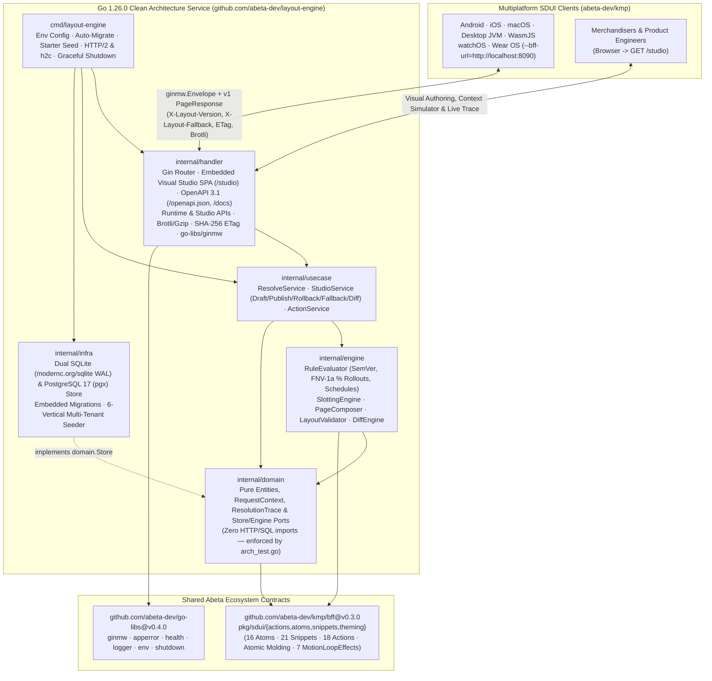

# Abeta Dynamic Layout Engine (`abeta-dev/layout-engine`)

[](https://github.com/Abeta-dev/layout-engine/actions/workflows/ci.yml)
[](https://github.com/Abeta-dev/layout-engine/actions/workflows/release.yml)
[](https://go.dev/)
[](llms.txt)
[](https://render.com/deploy?repo=https://github.com/Abeta-dev/layout-engine)
[](LICENSE)

**Abeta Dynamic Layout Engine** (`github.com/abeta-dev/layout-engine`) is an open-source, multi-tenant, rule-driven **Server-Driven UI (SDUI) Layout Engine & Visual Layout Studio** written in **Go 1.26.0** with strict Clean Architecture.

Purpose-built for high-velocity quick-commerce storefronts, food delivery, event ticketing, multi-category marketplaces, swipe discovery, B2B wholesale RFQ flows, and wearable glances, it emits **1:1 wire-compatible `v1` SDUI contracts** directly from [`github.com/abeta-dev/kmp/bff@v0.3.0`](https://github.com/Abeta-dev/kmp) wrapped in [`github.com/abeta-dev/go-libs@v0.4.0`](https://github.com/Abeta-dev/go-libs) envelopes—making it an immediate **drop-in BFF replacement** for **`abeta-dev/kmp`** clients across Android, iOS, macOS, Desktop JVM, WasmJS, watchOS, and Wear OS.

---

## Architecture Overview

Dependencies strictly follow the **Uncle Bob Dependency Rule** (`internal/domain` and `internal/engine` contain zero HTTP, Gin, or SQL driver imports—guarded by `internal/domain/arch_test.go`).



---

## Quick Start (Zero-Config in 30 Seconds)

### 1. Start the Layout Engine (Pure-Go SQLite + Auto-Migration + Starter Seed)

Requires only **Go 1.26.0**—no external database or Node.js build required:

```bash
git clone https://github.com/Abeta-dev/layout-engine.git
cd layout-engine
go run ./cmd/layout-engine
```

On first launch, the engine binds to **`:8090`**, initializes `layout-engine.db` in SQLite WAL mode, applies embedded migrations, and idempotently seeds **6 multi-tenant vertical workspaces**, each equipped with all **21 KMP `v1` widget templates**, curated widgets, targeting & dynamic slotting rules, published `v1` snapshots, guaranteed fallbacks, splash configs, and theme token overrides:

| Tenant Slug | Vertical Workspace | Published Dynamic Layouts | Key Showcase Highlights |
| :--- | :--- | :--- | :--- |
| **`abeta-fresh`** *(default)* | Abeta Fresh — Quick-Commerce Grocery | `store-home`, `fresh-home`, `flash-sale`, `home`, `catalog`, `form-demo`, `containers`, `watch-status` | 8-min grocery `marquee_strip` ticker, Flash Drop `nudge_bar` (w/ `CountdownAtom`), molded `composed_block` Loyalty Stamp card, `search_bar` + `chip_group`, responsive `grid`, `FloatingCartSpec` (`$15` free-delivery threshold nudge -> `/api/v1/fresh/orders/express`), VIP/morning slotting, and Watch glance |
| **`abeta-bites`** | Abeta Bites — Food Delivery & Dining | `bites-home`, `bites-restaurant`, `bites-order-track` | Dining `search_bar` + `chip_group`, restaurant cards, menu `product_card` grid with `FloatingCartSpec` (`/api/v1/bites/orders`), animated 4-step `order_tracker` (`#BTS-4091`), Mumbai/VIP dinner slotting |
| **`abeta-pulse`** | Abeta Pulse — Events, Movies & Dining Tickets | `pulse-home`, `pulse-event-detail` | Concerts/IMAX/comedy `search_bar` + `chip_group`, spotlight banner, seat-tier booking (`/api/v1/pulse/bookings`), weekend spotlight slotting |
| **`abeta-mart`** | Abeta Mart — Multi-Category Marketplace | `mart-home`, `mart-product-detail` | Category `search_bar` + `chip_group`, Lightning Deals `carousel`, responsive `grid`, specs `accordion`, VIP lightning deal slotting |
| **`abeta-spark`** | Abeta Spark — Swipe Discovery & Matches | `spark-deck`, `spark-matches` | City `header_v1`, discovery `chip_group`, 4-profile interactive `swipe_deck` (`/api/v1/spark/swipe` + undo), match `action_row`s, evening boost slotting |
| **`abeta-trade`** | Abeta Trade — B2B Wholesale & RFQ Sourcing | `trade-home`, `trade-supplier` | GST-verified wholesale `search_bar` + `chip_group`, MOQ supplier cards, validated RFQ `form_v1` (`/api/v1/trade/rfq`), enterprise procurement slotting |

### 2. Explore the Embedded Visual Layout Studio & API Docs

- **Visual Layout Studio SPA**: [http://localhost:8090/studio](http://localhost:8090/studio)
- **Interactive Scalar API Docs**: [http://localhost:8090/docs](http://localhost:8090/docs)
- **OpenAPI 3.1 JSON Spec**: [http://localhost:8090/openapi.json](http://localhost:8090/openapi.json)
- **LLM Reference Docs (`llmstxt.org`)**: [http://localhost:8090/llms.txt](http://localhost:8090/llms.txt) · [http://localhost:8090/llms-full.txt](http://localhost:8090/llms-full.txt)
- **Resolve a Dynamic Page with Live Trace**:
  ```bash
  curl "http://localhost:8090/api/v1/pages/store-home?include_trace=true&city=Bengaluru&segment=vip&platform=ios&app_version=2.1.0"
  ```

### 3. Connect `abeta-dev/kmp` as a Drop-In BFF

Point the `abeta-dev/kmp` Compose Multiplatform `:sample-app` directly at your local Layout Engine:

```bash
(cd ../kmp/kmp && ./gradlew :sample-app:run --args="--bff-url=http://localhost:8090")
```

Every layout edit, slot reorder, targeting rule, or rollback published in **`/studio`** reflects immediately in the KMP app—zero client redeployment required.

### 4. Production Deployment with PostgreSQL 17 (Docker Compose)

```bash
docker compose up --build
```

Starts **`postgres:17-alpine`** + **`abeta-layout-engine`** with healthchecks, automatic PostgreSQL migrations, and starter seeding on `http://localhost:8090`. See [.env.example](.env.example) for all configuration knobs.

---

## Feature Matrix

| Capability | Details |
| :--- | :--- |
| **Multi-Tenant Isolation** | First-class `Tenant` scoping across templates, widgets, layouts, rules, slotting, snapshots, fallbacks, splash configs, token overrides, and audit logs (`?tenant=` or `X-Tenant-ID`, default `abeta-fresh`; 6 pre-seeded vertical workspaces). |
| **21 KMP `v1` Snippet Templates & Atomic Molding** | Full coverage of all 21 `abeta-dev/kmp` (`bff@v0.3.0`) SnippetTypes: `header_v1`, `banner_v1`, `metric_card`, `card_v1`, `action_row`, `form_v1`, `empty_state`, `divider`, `spacer`, `carousel`, `grid`, `tabs`, `accordion`, `product_card`, `search_bar`, `chip_group`, `swipe_deck`, `nudge_bar`, `marquee_strip`, `order_tracker`, and the **`composed_block`** Atomic Snippet Molding Engine (depth `<= 6`) + `FloatingCartSpec` free-delivery threshold nudges & 7 ambient `MotionLoopEffect`s. |
| **Deterministic Rule Evaluator** | `all` (AND) / `any` (OR) match modes across 13 operators: `eq`, `neq`, `in`, `not_in`, `gt`, `gte`, `lt`, `lte`, `semver_gte`, `semver_lt`, `contains`, `regex`, and deterministic FNV-1a `bucket_pct` (`%` rollouts). |
| **UTC Schedule Windows** | Gate rules, layout slots, slotting injections, and splash screens by `start_at`/`end_at` timestamps, `days_of_week` (`0=Sun..6=Sat`), and half-open `start_hour_utc..end_hour_utc` windows (including overnight wrap-around like `22..4`). |
| **Dynamic Slotting Engine** | Runtime `insert`, `prepend`, `append`, and `replace` widget injections ordered by `priority`, honoring `Pinned` base slots, preventing duplicate widgets, and re-indexing slots sequentially. |
| **Immutable Snapshots & Rollback** | Drafts are schema- and cycle-validated (`POST .../validate`) before publishing immutable `PublishedSnapshot` versions; roll back to any historical version in one call with field-level JSON diffs in `ChangeLogEntry`. |
| **Automatic Fallback Chain** | Pre-validated `FallbackLayout` snapshots serve automatically if runtime snapshot resolution fails, annotating responses with `X-Layout-Fallback: true` and `ResolutionTrace.used_fallback`. |
| **Rule-Targeted Splash & Tokens** | Dynamically target launch splash screens (`GET /api/v1/config/splash`) and runtime design token overrides (`GET /api/v1/catalog/tokens`). |
| **Embedded Visual Layout Studio** | Single-binary embedded SPA at `GET /studio` for browsing tenants, editing slots/rules/slotting, simulating device/city/segment/time contexts, inspecting `ResolutionTrace`, publishing, and rolling back. |
| **Dual SQLite + PostgreSQL 17** | Zero-config pure-Go SQLite WAL (`modernc.org/sqlite`, `CGO_ENABLED=0`) for local/edge runs; full PostgreSQL 17 (`pgx`) with healthchecked Docker Compose for production. |
| **OpenAPI 3.1 + Scalar Docs** | Live OpenAPI 3.1 schema at `GET /openapi.json` and interactive Scalar API Reference UI at `GET /docs`. |
| **Production Transport & Observability** | HTTP/1.1 + `h2c` + TLS HTTP/2, negotiated Brotli (`br`) & gzip compression, SHA-256 `ETag`/`304`, `/healthz`, `/readyz`, `/metrics`, plus optional rate limiting and fail-closed JWT auth. |

---

## API Surface Summary

### Studio UI, Docs & Observability
- `GET /studio` — Embedded Visual Layout Studio SPA
- `GET /openapi.json` — OpenAPI 3.1 specification
- `GET /docs` — Interactive Scalar API Reference UI
- `GET /llms.txt`, `GET /llms-full.txt` — Embedded plain-text `llmstxt.org` index & full LLM engineering reference
- `GET /healthz`, `GET /readyz`, `GET /metrics` — Liveness, readiness, and telemetry probes

### Runtime KMP-Compatible SDUI API (`ginmw.Envelope`)
- `GET /api/v1/screens` — List published dynamic screens for a tenant
- `GET /api/v1/screens/:screenId` — Drop-in KMP `PageResponse` resolver (sets `X-Layout-Version` & optional `X-Layout-Fallback: true`)
- `GET /api/v1/pages/:slug` — Resolve dynamic page; add `?include_trace=true` to return `{ page, trace }`
- `GET /api/v1/config/splash` — Resolve rule- and schedule-targeted splash configuration
- `GET /api/v1/catalog/tokens` — Resolve base design token catalog merged with matching `TokenOverride`s
- `POST /api/v1/actions/execute` — Execute SDUI `ActionTrigger`s (all 18 `v1` action types)
- `POST /api/v1/orders/express` — Quick-commerce express checkout returning celebration & toast follow-up actions

### Studio Authoring & Governance API (`/api/v1/studio/*`)
- `GET|POST /api/v1/studio/tenants`
- `GET /api/v1/studio/templates`
- `GET|POST /api/v1/studio/widgets`, `DELETE /api/v1/studio/widgets/:id`
- `GET /api/v1/studio/layouts`, `GET|PUT /api/v1/studio/layouts/:slug`
- `POST /api/v1/studio/layouts/:slug/{validate,publish,rollback,fallback,preview}`, `GET /api/v1/studio/layouts/:slug/versions`
- `GET|POST /api/v1/studio/rules`, `DELETE /api/v1/studio/rules/:id`
- `GET|POST /api/v1/studio/slotting`, `DELETE /api/v1/studio/slotting/:id`
- `GET|POST /api/v1/studio/splash`
- `GET|POST /api/v1/studio/tokens`
- `GET /api/v1/studio/changelog`

---

## Documentation & Engineering Guides

- [llms.txt](llms.txt) · [llms-full.txt](llms-full.txt) — `llmstxt.org` index and single-file LLM engineering reference (also served live at `GET /llms.txt` and `GET /llms-full.txt`)
- [docs/architecture.md](docs/architecture.md) — Clean Architecture layers, domain ports, dual-database schema, and runtime resolution pipeline
- [docs/studio-and-rules.md](docs/studio-and-rules.md) — Visual Layout Studio workflows, rule operators, UTC schedule windows, dynamic slotting, snapshots, and curl cookbook
- [docs/kmp-integration.md](docs/kmp-integration.md) — Integrating `abeta-dev/kmp` (`:sample-app`, `:storybook`, `:sdui-layout`, `:watch-companion`), context headers, actions, and caching
- [AGENTS.md](AGENTS.md) · [CLAUDE.md](CLAUDE.md) · [GEMINI.md](GEMINI.md) — AI coding agent contracts and verification gates
- [skills/abeta-layout-engine/SKILL.md](skills/abeta-layout-engine/SKILL.md) · [agents/layout-engine-owner.md](agents/layout-engine-owner.md) — Domain skill & Code Owner review persona
- Companion Abeta Ecosystem: [`Abeta-dev/kmp`](https://github.com/Abeta-dev/kmp) · [`Abeta-dev/sdui-bff`](https://github.com/Abeta-dev/sdui-bff) · [`Abeta-dev/go-libs`](https://github.com/Abeta-dev/go-libs)
- [CONTRIBUTING.md](CONTRIBUTING.md) · [SECURITY.md](SECURITY.md) · [CHANGELOG.md](CHANGELOG.md) · [LICENSE](LICENSE)

---

## Verification & Development Commands

```bash
make run        # Start on :8090 with zero-config SQLite + 6-vertical starter seed
make test-race  # Run go test -count=1 -race -cover ./...
make verify     # Run ./scripts/verify_all.sh (hygiene, gofmt, go vet, race tests, static build)
make docker-up  # Start PostgreSQL 17 + layout-engine via docker-compose.yaml
```
