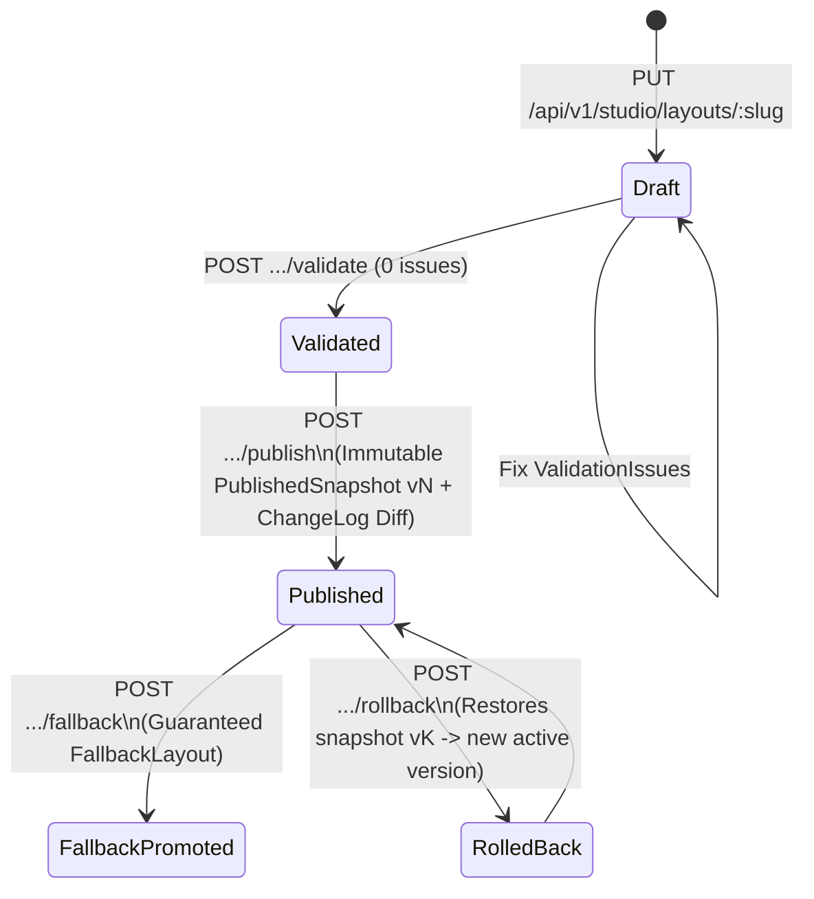

# Visual Layout Studio, Targeting Rules & Dynamic Slotting

This guide explains how product teams and merchandisers author dynamic SDUI screens, configure targeting rules and schedule windows, inject widgets with dynamic slotting, debug resolution traces, and safely publish or roll back versions in **`abeta-dev/layout-engine`**.

---

## 1. Embedded Visual Layout Studio (`GET /studio`)

The engine ships with a single-binary embedded Visual Layout Studio SPA served at **`http://localhost:8090/studio`** (embedded via `internal/handler/studio_assets/`—zero separate frontend deployment needed).

From `/studio`, you can:
1. **Switch Tenants** across all **6 pre-seeded vertical workspaces** (`abeta-fresh`, `abeta-bites`, `abeta-pulse`, `abeta-mart`, `abeta-spark`, `abeta-trade`) or custom workspaces.
2. **Browse all 21 KMP `v1` Snippet Templates** (`bff@v0.3.0`, including `search_bar`, `chip_group`, `swipe_deck`, `nudge_bar`, `marquee_strip`, `order_tracker`, and the **`composed_block`** Atomic Snippet Molding Engine) and inspect/create reusable **Widgets** with 7 ambient `MotionLoopEffect`s (`pulse`, `shimmer`, `wiggle`, `float`, `heartbeat`, `glow_ring`, `marquee`).
3. **Edit Draft Layouts**: reorder slots, bind targeting rules or UTC schedules per slot, lock critical hero banners with `pinned: true`, and configure page-level chrome (`ToolbarSpec`, `FloatingCartSpec` with free-delivery threshold nudges, `AdaptivePageSpec`, `PaginationSpec`, `PullToRefresh`).
4. **Simulate Live Contexts**: preview either the active **Published Snapshot** or **Draft** (`POST /api/v1/studio/layouts/:slug/preview`) for any combination of platform, app version, city, zone, user segment, user ID, window class, dark mode, custom attributes, and simulated timestamp (`at`).
5. **Inspect `ResolutionTrace`**: see exact matched rules, applied slotting rules, skipped slots, fallback usage, and resolution latency in milliseconds.
6. **Validate, Publish, Rollback & Audit**: validate drafts before publishing immutable snapshots, promote a fallback snapshot, roll back to any historical version, and review field-level JSON diffs in the **ChangeLog**.

All Studio write requests accept an optional `X-Studio-Actor` header (defaults to `studio-admin`) recorded on snapshots and audit entries.

---

## 2. Authoring & Governance Lifecycle



### Pre-Publish Validation Rules (`DefaultLayoutValidator`)

Calling `POST /api/v1/studio/layouts/:slug/validate` (and automatically during `publish`) enforces:
- Non-empty, URL-safe `slug` matching `^[a-z0-9][a-z0-9_-]*$` and non-empty `title`.
- Valid `page_config.adaptive_layout.layout_mode` (`single_column`, `centered`, or `split_pane`).
- Unique non-empty `slot_id` across all slots.
- Every enabled slot references an existing `widget_id` whose `snippet_type` is one of the **21 KMP `v1` SnippetTypes** (`header_v1`, `banner_v1`, `metric_card`, `card_v1`, `action_row`, `form_v1`, `empty_state`, `divider`, `spacer`, `carousel`, `grid`, `tabs`, `accordion`, `product_card`, `search_bar`, `chip_group`, `swipe_deck`, `nudge_bar`, `marquee_strip`, `order_tracker`, `composed_block`).
- Positive integer `columns` on `grid` widgets.
- Valid inline snippet envelopes (`snippet_id` + supported `snippet_type`) on `carousel`, `grid`, `accordion`, and `tabs`.
- Non-empty `id` and `title` on every tab entry in `tabs`.
- Non-empty `title` (and optional `progress` in `0..1`) on `nudge_bar`, non-empty `text` on every `marquee_strip` item, non-empty `headline` and valid `steps` on `order_tracker`, and a valid `root` tree on **`composed_block`** using the 17 canonical `ComposedNodeKind`s (`column`, `row`, `box`, `card`, `flow_row`, `text`, `button`, `tag`, `icon`, `image`, `avatar`, `progress`, `divider`, `spacer`, `stepper`, `countdown`, `rolling_counter`) with enforced **`maxDepth <= 6`** (`max_depth_exceeded`).
- Recursive **cycle detection (`cycle_detected`)** across `child_widget_ids` / `widget_ids` container references.

---

## 3. Targeting Rules & `RequestContext`

### Context Extraction (Query Params & HTTP Headers)

Runtime endpoints extract a `domain.RequestContext` preferring query parameters first, then HTTP headers, then defaults:

| Context Field | Query Parameter | HTTP Header | Default |
| :--- | :--- | :--- | :--- |
| `tenant_slug` | `tenant` | `X-Tenant-ID` | `abeta-fresh` |
| `platform` | `platform` | `X-Platform` | `desktop` |
| `app_version` | `app_version` | `X-App-Version` | `1.0.0` |
| `city` | `city` | `X-City` | `Bengaluru` |
| `zone` | `zone` | `X-Zone` | `koramangala-01` |
| `segment` | `segment` | `X-User-Segment` | `standard` |
| `user_id` | `user_id` | `X-User-ID` | `guest` |
| `window_class` | `window_class` | `X-Window-Class` | `compact` |
| `dark_mode` | `dark_mode` | `X-Dark-Mode` | `false` |
| `now` | `at` (RFC3339 UTC) | — | Current UTC time |
| `attributes.<k>` | `attr_<k>=<value>` | — | `{}` |

### Rule Evaluation & Supported Operators (`DefaultRuleEvaluator`)

Each `TargetingRule` combines:
- `enabled`: boolean gate (disabled rules always evaluate to `false`).
- `schedule`: optional `ScheduleWindow` checked first in UTC.
- `match_mode`: `"all"` (AND, default) or `"any"` (OR).
- `conditions`: list of `{ field, operator, value }` predicates.

| Operator | Semantics | Example |
| :--- | :--- | :--- |
| `eq`, `neq` | Case-insensitive string, boolean, or numeric equality / inequality | `{"field": "city", "operator": "eq", "value": "Bengaluru"}` |
| `in`, `not_in` | Membership against JSON array or comma-separated string | `{"field": "platform", "operator": "in", "value": ["ios", "android"]}` |
| `gt`, `gte`, `lt`, `lte` | Floating-point numeric comparisons | `{"field": "cart_total", "operator": "gte", "value": 499}` |
| `semver_gte`, `semver_lt` | SemVer 2.0 comparison (handles optional `v` prefix and prerelease precedence) | `{"field": "app_version", "operator": "semver_gte", "value": "2.0.0"}` |
| `contains` | Case-insensitive substring match | `{"field": "zone", "operator": "contains", "value": "koramangala"}` |
| `regex` | Go RE2 regular expression match | `{"field": "zone", "operator": "regex", "value": "^blr-[0-9]+$"}` |
| `bucket_pct` | Deterministic **FNV-1a 32-bit** percentage rollout (`fnv32a(ruleKey + ":" + seed) % 100 < pct`). Uses the field value, falling back to `user_id` or context tuple. | `{"field": "user_id", "operator": "bucket_pct", "value": 25}` |

---

## 4. UTC Schedule Windows

Rules, layout slots, slotting rules, and splash configs accept an optional `ScheduleWindow` evaluated in UTC:

```json
{
  "start_at": "2026-11-01T00:00:00Z",
  "end_at": "2026-12-31T23:59:59Z",
  "days_of_week": [5, 6, 0],
  "start_hour_utc": 18,
  "end_hour_utc": 2
}
```

- `days_of_week`: `0 = Sunday` through `6 = Saturday` (UTC).
- `start_hour_utc` / `end_hour_utc`: half-open `[start, end)` semantics when `start != end`, including **overnight wrap-around windows** (for example, `start_hour_utc: 18`, `end_hour_utc: 2` matches UTC hours `18, 19, 20, 21, 22, 23, 0, 1`), and exact single-hour match when `start == end`.

---

## 5. Dynamic Slotting Engine (`DefaultSlottingEngine`)

Dynamic `SlottingRule` entries modify a published layout's base slot list at runtime without requiring a full layout republish—ideal for flash sales, regional hero overrides, and time-boxed promo banners.

1. Candidate enabled rules for `layout_slug` are sorted by **`priority` descending** (tie-broken by `id` ascending).
2. Each candidate checks its `ScheduleWindow` and optional `rule_id`.
3. Matching rules mutate the slot list using one of four actions:
   - `prepend`: inserts at index `0`.
   - `append`: appends to the end of the slot list.
   - `insert`: inserts at `target_position` (clamped to `[0, len]`).
   - `replace`: replaces the slot at `target_position`. If the target slot has **`pinned: true`**, the pinned slot is preserved and the injected widget is inserted immediately after it (`idx + 1`).
4. **Deduplication**: Higher-priority slotting rules retain widget ownership, widgets locked in a pinned base slot are never duplicated, prior unpinned duplicates of an injected `widget_id` are removed, and final positions are re-indexed `0..N-1`.

---

## 6. Pre-Seeded Multi-Tenant Vertical Workspaces (6 Tenants · 21 SnippetTypes)

On zero-config boot (`go run ./cmd/layout-engine`), `SeedDefaultData` idempotently populates **6 multi-tenant vertical workspaces**, each equipped with all **21 canonical KMP `v1` widget templates** (`header_v1`, `banner_v1`, `metric_card`, `card_v1`, `action_row`, `form_v1`, `empty_state`, `divider`, `spacer`, `carousel`, `grid`, `tabs`, `accordion`, `product_card`, `search_bar`, `chip_group`, `swipe_deck`, `nudge_bar`, `marquee_strip`, `order_tracker`, `composed_block`), curated widgets, targeting rules, dynamic slotting rules, immutable `v1` snapshots, guaranteed fallbacks, splash configs, and branded token overrides:

| Tenant Slug | Workspace Name | Published Layouts | Rules & Slotting Highlights |
| :--- | :--- | :--- | :--- |
| **`abeta-fresh`** *(default)* | Abeta Fresh — Quick-Commerce Grocery | `store-home`, `fresh-home`, `flash-sale`, `home`, `catalog`, `form-demo`, `containers`, `watch-status` | 5 targeting rules (VIP, Bengaluru, morning window, mobile SemVer, 50% rollout); VIP & morning slotting on `store-home` + VIP slotting on `fresh-home`; `fresh-home` features `marquee_strip`, Flash Drop `nudge_bar` (w/ `CountdownAtom`), molded `composed_block` Loyalty Stamp card & `FloatingCartSpec` (`free_delivery_threshold_cents: 1500`) -> `POST /api/v1/fresh/orders/express` |
| **`abeta-bites`** | Abeta Bites — Food Delivery & Dining | `bites-home`, `bites-restaurant`, `bites-order-track` | `mumbai_or_vip` (`city == "Mumbai"` OR `segment == "vip"`) and `dinner_rush_window` slotting on `bites-home`; `FloatingCartSpec` -> `POST /api/v1/bites/orders`; 4-step animated `order_tracker` (`#BTS-4091`) on `bites-order-track` |
| **`abeta-pulse`** | Abeta Pulse — Events, Movies & Dining Tickets | `pulse-home`, `pulse-event-detail` | `weekend_spotlight` (Fri–Sun UTC) slotting banner on `pulse-home`; event cards navigating to `pulse-event-detail` with seat-tier booking (`POST /api/v1/pulse/bookings`) |
| **`abeta-mart`** | Abeta Mart — Multi-Category Marketplace | `mart-home`, `mart-product-detail` | `mart_vip_segment` VIP lightning deal slotting on `mart-home`; Lightning Deals `carousel`, responsive `grid`, and product specs `accordion` |
| **`abeta-spark`** | Abeta Spark — Swipe Discovery & Matches | `spark-deck`, `spark-matches` | `evening_boost_window` slotting on `spark-deck`; 4-profile `swipe_deck` (`POST /api/v1/spark/swipe` + undo) and match `action_row` widgets |
| **`abeta-trade`** | Abeta Trade — B2B Wholesale & RFQ Sourcing | `trade-home`, `trade-supplier` | `enterprise_buyers` (`segment in ["enterprise", "vip"]`) procurement desk slotting on `trade-home`; MOQ supplier cards and validated RFQ `form_v1` (`POST /api/v1/trade/rfq`) |

Pass `?tenant=<slug>` or `X-Tenant-ID: <slug>` on any Runtime or Studio endpoint to switch workspaces dynamically.

---

## 7. Studio API Cookbook (`curl`)

### Preview a Draft with Simulated Context & Trace

```bash
curl -s -X POST "http://localhost:8090/api/v1/studio/layouts/store-home/preview" \
  -H "Content-Type: application/json" \
  -d '{
    "draft": true,
    "context": {
      "platform": "ios",
      "app_version": "2.2.0",
      "city": "Bengaluru",
      "segment": "vip",
      "user_id": "usr_42",
      "window_class": "expanded",
      "dark_mode": false,
      "at": "2026-11-21T14:00:00Z"
    }
  }' | jq .
```

### Validate, Publish, Promote Fallback & Rollback

```bash
# 1. Validate draft
curl -s -X POST "http://localhost:8090/api/v1/studio/layouts/store-home/validate" | jq .

# 2. Publish immutable snapshot (records actor & field-level diff)
curl -s -X POST "http://localhost:8090/api/v1/studio/layouts/store-home/publish" \
  -H "Content-Type: application/json" \
  -H "X-Studio-Actor: merchandising-lead" \
  -d '{"comment": "Launch weekend flash sale hero banner"}' | jq .

# 3. Promote latest published snapshot to guaranteed FallbackLayout
curl -s -X POST "http://localhost:8090/api/v1/studio/layouts/store-home/fallback" \
  -H "Content-Type: application/json" \
  -H "X-Studio-Actor: merchandising-lead" \
  -d '{}' | jq .

# 4. Inspect version history & roll back to version 1
curl -s "http://localhost:8090/api/v1/studio/layouts/store-home/versions" | jq .
curl -s -X POST "http://localhost:8090/api/v1/studio/layouts/store-home/rollback" \
  -H "Content-Type: application/json" \
  -H "X-Studio-Actor: oncall-sre" \
  -d '{"version": 1, "comment": "Revert weekend hero banner"}' | jq .
```

### Inspect Audit ChangeLog

```bash
curl -s "http://localhost:8090/api/v1/studio/changelog?limit=20" | jq .
```

---

## Related Guides

- [Clean Architecture & Persistence](architecture.md)
- [`abeta-dev/kmp` Client Integration](kmp-integration.md)
- [Repository Overview](../README.md)
